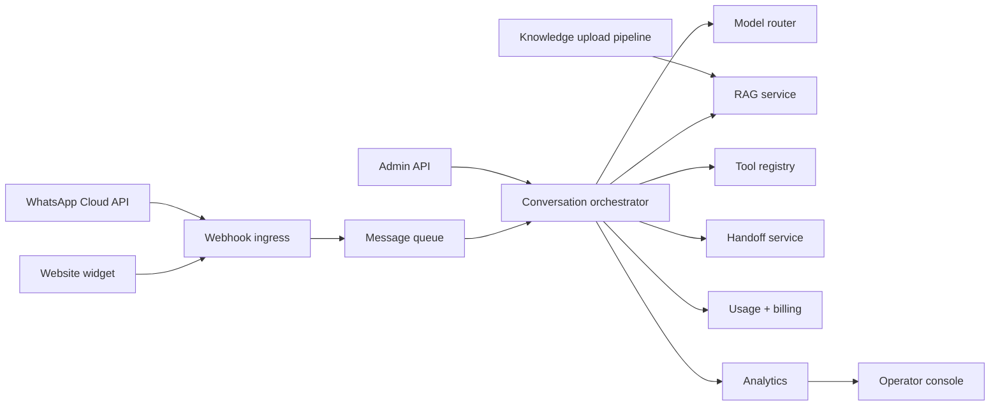

# System design

## Overview

The platform is a multi-tenant AI customer support and lead qualification platform for South African SMBs. It combines a conversation orchestrator, a retrieval layer, a flexible LLM gateway, and channel adapters for WhatsApp and a web widget.

## Functional requirements

- Support 200 tenants in year one with a target of 300 customer conversations per tenant per month.
- Support 30 concurrent conversations per tenant spike window without cross-tenant leakage.
- Provide a website widget and WhatsApp business integration for the same brand.
- Allow a business to upload documents, FAQs, website links, and text knowledge sources.
- Route conversations to a human staff inbox when escalation triggers are met.
- Track usage and cost per conversation, tenant, model, and channel.
- Maintain a secure operator console with tenant-level controls.

## Non-functional requirements

- p95 first-token latency: <3s on the website widget.
- p95 end-to-end WhatsApp reply time: <8s.
- Availability target: 99.5% monthly.
- Zero cross-tenant data leakage.
- Logs and traces must include `tenantId`, `conversationId`, `turnId`, and provider metadata.
- All inbound webhooks must be signed and validated.

## High-level component diagram

## Data model

Core entities include:

- `tenants`
- `users` and `memberships`
- `channels` (WhatsApp number, widget key, allowed origins)
- `agents` (versioned business config)
- `knowledge_sources` and `knowledge_chunks`
- `contacts`, `conversations`, `messages`
- `handoffs`, `leads`, `tools`, `tool_connections`
- `usage_records`, `plans`, `subscriptions`, `audit_log`
- `model_routes`, `eval_cases`

## Data flow

### Inbound WhatsApp message

1. Meta webhook arrives with signature header.
2. Verify signature and message ID deduplication.
3. Enqueue message to a per-tenant queue.
4. Conversation orchestrator reads state and triggers a turn.
5. Model router selects the best model for purpose and tenant plan.
6. RAG service filters docs by tenant and returns citations.
7. If confidence is low or escalation required, handoff is queued.
8. Reply is sent back to Meta Cloud API.

### Website widget

1. Browser loads the script and requests a signed session token.
2. A token is issued for the tenant public key, with a short TTL.
3. Widget opens a streaming connection to the platform.
4. The conversation orchestrator responds with streaming tokens.
5. The widget can capture lead details and deep-link to WhatsApp if needed.

### Human takeover

1. Agent marks the conversation as `HANDOFF_REQUESTED`.
2. Operator inbox is updated with the transcript and customer context.
3. Human staff response is routed to the same conversation.
4. Conversation either resumes AI mode or stays with human until resolved.

## Queueing and concurrency

- One in-flight turn per conversation.
- Dedup of inbound ID and webhook retries.
- Dead-letter queue for repeated failures.
- Rate-limited model gateway with token buckets, retry-after handling, and circuit breakers.
- Backpressure when external providers are throttled.

## Caching

- FAQ answer cache keyed by `(tenantId, normalized question hash, knowledge version)`.
- Embedding cache by input text hash and model version.
- Short-lived conversation state cache for active threads.

## Reliability and scale

- Horizontal scaling using stateless app servers and managed Postgres.
- Use pgvector for embeddings, plus row-level security and strict tenant filters.
- Provide degraded user experience: FAQ fallback, human handoff, canned responses during provider outage.

## Observability

- Structured logs with `tenantId`, `conversationId`, `turnId`.
- OpenTelemetry traces across LLM calls and tools.
- Metrics: latency, cost, messages/day, handoff rate, resolution rate, model success rate.

## Trade-offs

- Postgres + pgvector offers better data control and tenant isolation than a Convex-only approach, but requires more operational design.
- OpenRouter enables a flexible and affordable model strategy, but also requires careful routing, budgeting, and fallback policy.
- A widget built with streaming SSE is simple and reliable, but a full socket architecture may be needed as complexity grows.

## Assumptions

- The platform begins with a shared-database multi-tenant model with rigorous RLS and row-level isolation.
- The initial observed model gateway is OpenRouter with provider-neutral abstractions.
- The first production hosting footprint is a single-region container deployment in South Africa-aware infrastructure or close enough to keep latency acceptable.
